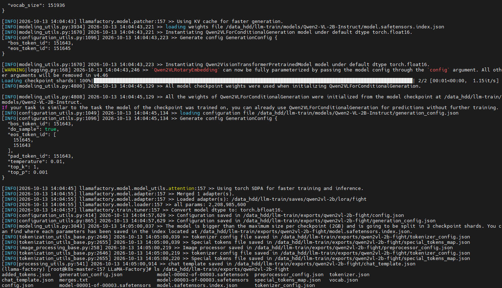
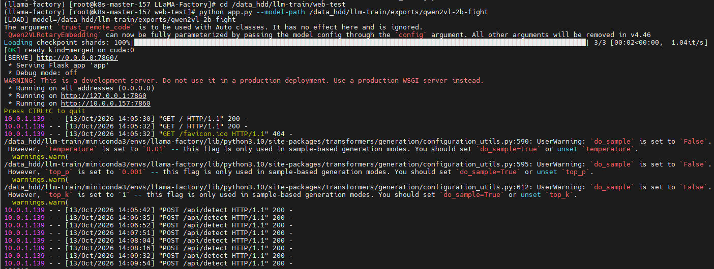
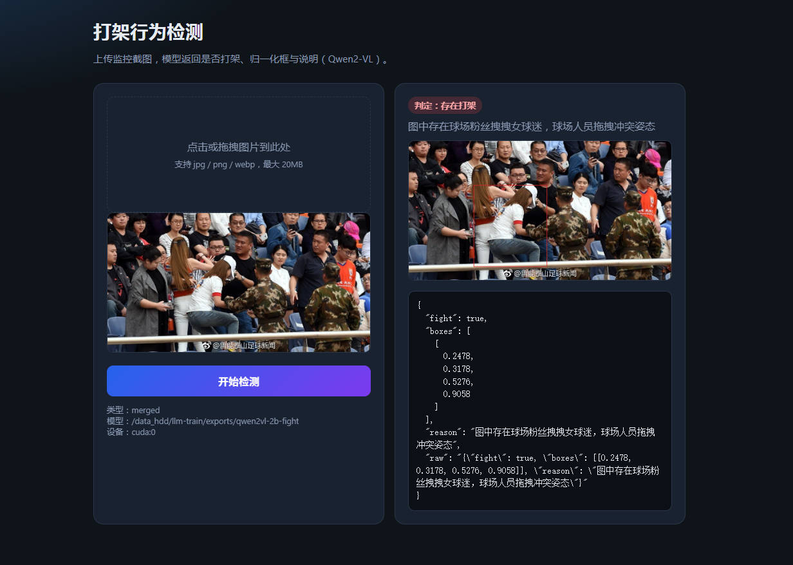

本文是一份 **Qwen2-VL-2B-Instruct** 打架检测微调手册。输入图片与固定问法，输出 JSON（`fight` / `boxes` / `reason`）。覆盖原理、目录、下载、安装、数据格式、注册、日常再训、Web 试用与固定版本。环境为 Driver 515.76 / CUDA 11.7 / 多×Tesla T4 16GB，目录 `/data_hdd/llm-train`，**普通 LoRA** + fp16（不量化），冻视觉塔，模板必须是 **`qwen2_vl`**。训练卡：`CUDA_VISIBLE_DEVICES=1,2,4,5,6,7`（避开占用中的 0/3）。

| 项 | 值 |
|----|-----|
| 数据 | `data/fight_vl_train.json` + `data/fight_vl_images/` |
| 训练 | `configs/qwen2vl_lora_fight.yaml` |
| 合并 | `configs/qwen2vl_merge_fight.yaml` |
| 适配器 | `/data_hdd/llm-train/saves/qwen2vl-2b/lora/fight` |
| 导出 | `/data_hdd/llm-train/exports/qwen2vl-2b-fight` |

**首次：** 下载 → 安装 → 注册数据 → 再训 → Web  
**改标注后再训：** 只跑「日常再训」。

完整链接表：`env/manifest.tsv`（与下载节一致）。可用 `bash scripts/download.sh` 按表拉取，或对表中 URL 直接 `wget`/`curl`。

<!-- more -->

<h2 id="c-1-0" class="mh1">一、原理：为什么这样训、模型如何学</h2>

<h2 id="c-1-1" class="mh2">1.1 要解决什么问题</h2>

业务目标不是随便聊图，而是：**给定一张图，稳定输出固定结构的 JSON**：

```text
{"fight": true/false, "boxes": [[x1,y1,x2,y2], ...], "reason": "..."}
```

基座 Qwen2-VL 已经会看图、会写字，但不会自动按我们的字段名、坐标约定、正负样本口径作答。微调的目的只有一件事：把「看图 → 吐我们要的 JSON」这件事练熟。

<h2 id="c-1-2" class="mh2">1.2 为什么用多模态 LLM，而不是单独的检测器</h2>

| 做法 | 优势 | 代价 |
|------|------|------|
| 专用检测（YOLO 等） | 框准、吞吐高 | 难输出自然语言 `reason`；换口径要重标重训一套 |
| **Qwen2-VL + SFT** | 一张图同时学会判打架、出框、写原因；改 prompt/标注即可改行为 | 框不如专用检测精；样本少时靠「背格式」 |

当前阶段优先 **可解释 JSON + 快速迭代标注**，所以用 VL 指令微调。

<h2 id="c-1-3" class="mh2">1.3 一条样本在训练时发生了什么</h2>

每条数据本质是一对「示范对话」：

1. **User**：`<image>` + 固定问法（判断是否打架、要归一化框、只输出 JSON）
2. **Assistant**：人工标好的标准答案 JSON（含 `fight` / `boxes` / `reason`）

训练时（LLaMA-Factory SFT）：

```text
图片 → 视觉塔编码成视觉 token
     ↓
与文字 token 拼成序列（template: qwen2_vl）
     ↓
语言模型自回归预测下一个 token
     ↓
只在 assistant 那段算交叉熵 loss（学「该怎么答」）
     ↓
反传更新 LoRA 参数（基座大权重基本不动）
```

模型学到的不是「内存里存了哪张图」，而是：**见到类似视觉模式 + 同样问法时，更倾向吐出同类 JSON**。正样本教「有冲突时 fight/boxes/reason」；负样本教「无冲突时 fight=false、boxes=[]、reason 说明为何不是」。`reason` 把决策说清楚，也约束模型别只靠乱猜 `fight`。

<h2 id="c-1-4" class="mh2">1.4 为什么选「普通 LoRA + 冻视觉塔」</h2>

| 选择 | 原因 |
|------|------|
| 用基座 VL，不从零训 | 2B 级从零看图不现实；借已有视觉与语言能力 |
| **LoRA**（低秩适配器） | 只训少量旁路矩阵，显存/存储小；合并后得到可部署整模 |
| **不量化（普通 LoRA）** | 比 QLoRA 拟合更稳；T4 上 2B + 冻视觉塔吃得下 |
| **冻视觉塔** | 视觉编码器参数大；打架任务主要是「已有视觉特征 → 语言侧组织成 JSON」，先训语言侧 LoRA 性价比高 |
| `template: qwen2_vl` | 必须与基座对话模板一致，图文才能正确拼进模型 |

推理时：合并后的模型再看新图 + 同一句 user 问法，按学会的分布生成 JSON——这就是「检测」在本方案里的含义。

<h2 id="c-1-5" class="mh2">1.5 数据质量如何决定上限</h2>

- 框乱、正负口径不一致 → 模型学到的是噪声，Web 上就会漏检/误检
- 负样本太少或 `reason` 太空（如只写「不是打架」）→ 易把路人、单人姿态判成打架
- 样本很少时要靠 **多 epoch** 把格式与口径「刻」进去；再训前 **删掉旧 LoRA/导出**，否则可能续训旧 checkpoint，新标注学不进去

标注工具只负责写出与训练一致的 JSON；**学得怎样，取决于标注是否一致、覆盖是否够**。

<h2 id="c-1-6" class="mh2">1.6 和操作流程的对应关系</h2>

```text
标注 JSON          → 提供「标准答法」
日常再训 (train)   → 用交叉熵把答法写入 LoRA
export 合并        → 把 LoRA 并进基座，得到可加载整模
web-test / diagnose→ 用同一问法验「会不会按 JSON 答」
```

下面各节是落盘路径、安装与命令。**改效果优先改数据与标注，再清权重重训**。

<h2 id="c-2-0" class="mh1">二、目录</h2>

```text
/data_hdd/llm-train/
├── offline/          # 安装包与 wheel 落盘
├── models/Qwen2-VL-2B-Instruct/
├── scripts/  env/  configs/  data/  web-test/
├── miniconda3/       # 安装后
├── LLaMA-Factory/    # 安装后
├── saves/
└── exports/
```

<h2 id="c-3-0" class="mh1">三、下载大文件（落盘路径 ← URL）</h2>

在仓库根目录执行（Windows 拷过来若报 pipefail：`sed -i 's/\r$//' scripts/*.sh`）：

```bash
cd /data_hdd/llm-train   # 或本机 train 目录；已存在且大小>0 的文件会跳过
bash scripts/download.sh              # 按 env/manifest.tsv 拉取大文件
bash scripts/download.sh --check-only # 只校验，不下载；缺文件会报错
```

<h2 id="c-3-1" class="mh2">3.1 基础包</h2>

| 落盘路径 | URL |
|----------|-----|
| `offline/miniconda.sh` | https://repo.anaconda.com/miniconda/Miniconda3-py310_24.7.1-0-Linux-x86_64.sh |
| `offline/LLaMA-Factory-v0.9.1.tar.gz` | https://github.com/hiyouga/LLaMA-Factory/archive/refs/tags/v0.9.1.tar.gz |
| `offline/wheels/bitsandbytes-0.42.0-py3-none-any.whl` | https://files.pythonhosted.org/packages/9b/63/489ef9cd7a33c1f08f1b2be51d1b511883c5e34591aaa9873b30021cd679/bitsandbytes-0.42.0-py3-none-any.whl |

<h2 id="c-3-2" class="mh2">3.2 torch cu118（Python 3.10）</h2>

| 落盘路径 | URL |
|----------|-----|
| `offline/torch-wheels/torch-2.2.2+cu118-cp310-cp310-linux_x86_64.whl` | https://download.pytorch.org/whl/cu118/torch-2.2.2%2Bcu118-cp310-cp310-linux_x86_64.whl |
| `offline/torch-wheels/torchvision-0.17.2+cu118-cp310-cp310-linux_x86_64.whl` | https://download.pytorch.org/whl/cu118/torchvision-0.17.2%2Bcu118-cp310-cp310-linux_x86_64.whl |
| `offline/torch-wheels/torchaudio-2.2.2+cu118-cp310-cp310-linux_x86_64.whl` | https://download.pytorch.org/whl/cu118/torchaudio-2.2.2%2Bcu118-cp310-cp310-linux_x86_64.whl |
| `offline/torch-wheels/nvidia_cublas_cu11-11.11.3.6-py3-none-manylinux1_x86_64.whl` | https://download.pytorch.org/whl/cu118/nvidia_cublas_cu11-11.11.3.6-py3-none-manylinux1_x86_64.whl |
| `offline/torch-wheels/nvidia_cuda_cupti_cu11-11.8.87-py3-none-manylinux1_x86_64.whl` | https://download.pytorch.org/whl/cu118/nvidia_cuda_cupti_cu11-11.8.87-py3-none-manylinux1_x86_64.whl |
| `offline/torch-wheels/nvidia_cuda_nvrtc_cu11-11.8.89-py3-none-manylinux1_x86_64.whl` | https://download.pytorch.org/whl/cu118/nvidia_cuda_nvrtc_cu11-11.8.89-py3-none-manylinux1_x86_64.whl |
| `offline/torch-wheels/nvidia_cuda_runtime_cu11-11.8.89-py3-none-manylinux1_x86_64.whl` | https://download.pytorch.org/whl/cu118/nvidia_cuda_runtime_cu11-11.8.89-py3-none-manylinux1_x86_64.whl |
| `offline/torch-wheels/nvidia_cudnn_cu11-8.7.0.84-py3-none-manylinux1_x86_64.whl` | https://download.pytorch.org/whl/cu118/nvidia_cudnn_cu11-8.7.0.84-py3-none-manylinux1_x86_64.whl |
| `offline/torch-wheels/nvidia_cufft_cu11-10.9.0.58-py3-none-manylinux1_x86_64.whl` | https://download.pytorch.org/whl/cu118/nvidia_cufft_cu11-10.9.0.58-py3-none-manylinux1_x86_64.whl |
| `offline/torch-wheels/nvidia_curand_cu11-10.3.0.86-py3-none-manylinux1_x86_64.whl` | https://download.pytorch.org/whl/cu118/nvidia_curand_cu11-10.3.0.86-py3-none-manylinux1_x86_64.whl |
| `offline/torch-wheels/nvidia_cusolver_cu11-11.4.1.48-py3-none-manylinux1_x86_64.whl` | https://download.pytorch.org/whl/cu118/nvidia_cusolver_cu11-11.4.1.48-py3-none-manylinux1_x86_64.whl |
| `offline/torch-wheels/nvidia_cusparse_cu11-11.7.5.86-py3-none-manylinux1_x86_64.whl` | https://download.pytorch.org/whl/cu118/nvidia_cusparse_cu11-11.7.5.86-py3-none-manylinux1_x86_64.whl |
| `offline/torch-wheels/nvidia_nccl_cu11-2.19.3-py3-none-manylinux1_x86_64.whl` | https://download.pytorch.org/whl/cu118/nvidia_nccl_cu11-2.19.3-py3-none-manylinux1_x86_64.whl |
| `offline/torch-wheels/nvidia_nvtx_cu11-11.8.86-py3-none-manylinux1_x86_64.whl` | https://download.pytorch.org/whl/cu118/nvidia_nvtx_cu11-11.8.86-py3-none-manylinux1_x86_64.whl |

<h2 id="c-3-3" class="mh2">3.3 Qwen2-VL-2B-Instruct（须含 preprocessor / chat_template）</h2>

| 落盘路径 | URL |
|----------|-----|
| `models/Qwen2-VL-2B-Instruct/model-00001-of-00002.safetensors` | https://hf-mirror.com/Qwen/Qwen2-VL-2B-Instruct/resolve/main/model-00001-of-00002.safetensors |
| `models/Qwen2-VL-2B-Instruct/model-00002-of-00002.safetensors` | https://hf-mirror.com/Qwen/Qwen2-VL-2B-Instruct/resolve/main/model-00002-of-00002.safetensors |
| `models/Qwen2-VL-2B-Instruct/model.safetensors.index.json` | https://hf-mirror.com/Qwen/Qwen2-VL-2B-Instruct/resolve/main/model.safetensors.index.json |
| `models/Qwen2-VL-2B-Instruct/config.json` | https://hf-mirror.com/Qwen/Qwen2-VL-2B-Instruct/resolve/main/config.json |
| `models/Qwen2-VL-2B-Instruct/generation_config.json` | https://hf-mirror.com/Qwen/Qwen2-VL-2B-Instruct/resolve/main/generation_config.json |
| `models/Qwen2-VL-2B-Instruct/preprocessor_config.json` | https://hf-mirror.com/Qwen/Qwen2-VL-2B-Instruct/resolve/main/preprocessor_config.json |
| `models/Qwen2-VL-2B-Instruct/chat_template.json` | https://hf-mirror.com/Qwen/Qwen2-VL-2B-Instruct/resolve/main/chat_template.json |
| `models/Qwen2-VL-2B-Instruct/tokenizer_config.json` | https://hf-mirror.com/Qwen/Qwen2-VL-2B-Instruct/resolve/main/tokenizer_config.json |
| `models/Qwen2-VL-2B-Instruct/tokenizer.json` | https://hf-mirror.com/Qwen/Qwen2-VL-2B-Instruct/resolve/main/tokenizer.json |
| `models/Qwen2-VL-2B-Instruct/vocab.json` | https://hf-mirror.com/Qwen/Qwen2-VL-2B-Instruct/resolve/main/vocab.json |
| `models/Qwen2-VL-2B-Instruct/merges.txt` | https://hf-mirror.com/Qwen/Qwen2-VL-2B-Instruct/resolve/main/merges.txt |

其余训练依赖 wheel（transformers 等）按 `env/requirements-*.txt` 用 pip 装；若需预下轮子，同样放进 `offline/wheels/`。

<h2 id="c-4-0" class="mh1">四、安装（仅首次）</h2>

始终在 **`llama-factory`**。pip：`--find-links` + `-c constraints-torch.txt`；bitsandbytes **0.42.0** 直装；Factory：`--no-build-isolation --no-deps -e .`。

```bash
cd /data_hdd/llm-train
sed -i 's/\r$//' scripts/* 2>/dev/null || true   # 去掉 Windows CRLF，避免 bash 报 pipefail

# --- conda 环境（Python 3.10）---
bash offline/miniconda.sh -b -p /data_hdd/llm-train/miniconda3   # -b 静默安装到指定前缀
eval "$(/data_hdd/llm-train/miniconda3/bin/conda shell.bash hook)"
conda create -y -n llama-factory python=3.10
conda activate llama-factory

WHEELS=/data_hdd/llm-train/offline/wheels          # 通用 wheel
TW=/data_hdd/llm-train/offline/torch-wheels        # torch/cu118 专用
C=/data_hdd/llm-train/env/constraints-torch.txt    # 钉死 cu118，防止 pip 拉成别的 CUDA

# --- torch：先装 nvidia 运行库，再装 torch 本体，再装其依赖 ---
pip install --no-deps ${TW}/nvidia_*.whl
pip install --no-deps ${TW}/torch-*.whl ${TW}/torchvision-*.whl ${TW}/torchaudio-*.whl
pip install --no-index --find-links=${WHEELS} --find-links=${TW} -c ${C} \
  -r env/requirements-torch-deps.txt               # --no-index：只用本地 wheel，不上外网索引

# --- LLaMA-Factory 源码目录（解压后目录名可能带版本号，统一改名为 LLaMA-Factory）---
tar -xzf offline/LLaMA-Factory-v0.9.1.tar.gz
extracted="$(tar -tzf offline/LLaMA-Factory-v0.9.1.tar.gz | head -1 | cut -d/ -f1)"
mv "${extracted}" LLaMA-Factory && cd LLaMA-Factory

# --- 训练依赖 + 可编辑安装 Factory ---
pip install --no-index --find-links=${WHEELS} --find-links=${TW} -c ${C} \
  -r /data_hdd/llm-train/env/requirements-build.txt
pip install --no-index --find-links=${WHEELS} --find-links=${TW} -c ${C} \
  -r /data_hdd/llm-train/env/requirements-train.txt  # 含 transformers、qwen-vl-utils、av 等
pip install --no-deps ${WHEELS}/bitsandbytes-*.whl     # 须 0.42.0；--no-deps 避免被升级
pip install --no-index --find-links=${WHEELS} --find-links=${TW} -c ${C} \
  --no-build-isolation --no-deps -e .                 # -e：源码可编辑；--no-deps：依赖已手动装齐

python /data_hdd/llm-train/scripts/verify_env.py      # 期望打印 RESULT: PASS
```

<h2 id="c-5-0" class="mh1">五、数据格式</h2>

`fight_vl_train.json` 与 `fight_vl_images/` **同级**。路径相对 Factory 的 `data/`。

```json
{"fight": true, "boxes": [[0.28, 0.35, 0.72, 0.91]], "reason": "两人近距离肢体冲突"}
```

| 约定 | 说明 |
|------|------|
| 框 | 归一化 0~1，`[x1,y1,x2,y2]` |
| 正样本 | `fight: true` + 框；`reason` 写为何打架 |
| 负样本 | `fight: false`，`boxes: []`；`reason` 写为何不是 |
| 标注 | `offline-sample-annotation`：类别与 reason 分开；只写同级 JSON |

<h2 id="c-6-0" class="mh1">六、注册数据集（仅首次）</h2>

```bash
# Factory 只认自己 data/ 下的相对路径；配置放 examples/ 供 CLI 读取
cp /data_hdd/llm-train/data/fight_vl_train.json \
   /data_hdd/llm-train/LLaMA-Factory/data/          # 标注 JSON
cp -r /data_hdd/llm-train/data/fight_vl_images \
      /data_hdd/llm-train/LLaMA-Factory/data/       # 图片目录（JSON 里路径相对此）
cp /data_hdd/llm-train/configs/qwen2vl_lora_fight.yaml \
   /data_hdd/llm-train/configs/qwen2vl_merge_fight.yaml \
   /data_hdd/llm-train/LLaMA-Factory/examples/      # 训练 / 合并 yaml
```

编辑 `LLaMA-Factory/data/dataset_info.json`，追加（见 `data/dataset_info.snippet.json`）；`dataset: fight_vl` 靠这里注册：

```json
"fight_vl": {
  "file_name": "fight_vl_train.json",
  "formatting": "sharegpt",
  "columns": { "messages": "messages", "images": "images" },
  "tags": {
    "role_tag": "role", "content_tag": "content",
    "user_tag": "user", "assistant_tag": "assistant"
  }
}
```

<h2 id="c-7-0" class="mh1">七、日常再训</h2>

基座 `models/` 不要删。先清旧适配器与导出，避免续训旧 checkpoint。

```bash
# --- 清旧权重（勿删 models/ 基座）；不删可能从旧 checkpoint 续训 ---
# 删除：LoRA 适配器目录 + 上次合并整模
rm -rf /data_hdd/llm-train/saves/qwen2vl-2b/lora/fight \
       /data_hdd/llm-train/exports/qwen2vl-2b-fight

# --- 同步最新标注与配置到 Factory（JSON / 图片 / yaml）---
cp /data_hdd/llm-train/data/fight_vl_train.json \
   /data_hdd/llm-train/LLaMA-Factory/data/
cp -r /data_hdd/llm-train/data/fight_vl_images \
      /data_hdd/llm-train/LLaMA-Factory/data/
cp /data_hdd/llm-train/configs/qwen2vl_lora_fight.yaml \
   /data_hdd/llm-train/configs/qwen2vl_merge_fight.yaml \
   /data_hdd/llm-train/LLaMA-Factory/examples/

# --- 六卡 DDP 训练（避开占用中的 GPU0/3）；可见卡自动并行 ---
eval "$(/data_hdd/llm-train/miniconda3/bin/conda shell.bash hook)"
conda activate llama-factory
export CUDA_VISIBLE_DEVICES=1,2,4,5,6,7
cd /data_hdd/llm-train/LLaMA-Factory
llamafactory-cli train examples/qwen2vl_lora_fight.yaml
# 产物：saves/qwen2vl-2b/lora/fight/（adapter + trainer_state.json）

# --- 合并 LoRA 进基座（单卡即可）；Web 加载的是导出目录 ---
export CUDA_VISIBLE_DEVICES=1
llamafactory-cli export examples/qwen2vl_merge_fight.yaml
ls /data_hdd/llm-train/exports/qwen2vl-2b-fight   # 应有 config / safetensors 等
```

训完看 `saves/qwen2vl-2b/lora/fight/trainer_state.json`：`global_step` 应明显 > 20，且 `train_loss` 下降。

合并导出完成后，适配器已并进基座，`exports/qwen2vl-2b-fight` 应有 config、safetensors、tokenizer 等整模文件：



<h2 id="c-8-0" class="mh1">八、Web 试用</h2>

<h2 id="c-8-1" class="mh2">8.1 启动服务</h2>

```bash
conda activate llama-factory
# 首次才需要：pip install -r /data_hdd/llm-train/web-test/requirements.txt
export CUDA_VISIBLE_DEVICES=1   # 推理单卡；勿与正在跑的训练抢同一组卡
cd /data_hdd/llm-train/web-test
python app.py --model-path /data_hdd/llm-train/exports/qwen2vl-2b-fight
# 浏览器：http://<主机IP>:7860/  （须指向刚 export 的目录）
```

服务起来后终端打印 `http://10.0.0.157:7860`，页面上传图片会打出 `POST /api/detect`：



复盘训练集正样本（打印 raw JSON 与检出率）：

```bash
python diagnose.py   # 同目录；默认查 exports 与若干 fight=true 图
```

<h2 id="c-8-2" class="mh2">8.2 检测效果</h2>

浏览器打开试用页，上传监控截图后点击「开始检测」。右侧给出判定、归一化框、`reason`，并在图上画出框：



<h2 id="c-8-3" class="mh2">8.3 现象对照</h2>

| 现象 | 更可能 |
|------|--------|
| 导出/LoRA 缺失 | 未合并或路径错 |
| `pixel_values=NO` | 推理未喂图 |
| `raw` 无 `fight`/`reason` 且 step 极小 | 训练未完成 |
| diagnose 正常、页面不行 | Web 未指向新导出 |

<h2 id="c-9-0" class="mh1">九、固定版本</h2>

| 组件 | 版本 |
|------|------|
| Python | 3.10 |
| torch | 2.2.2+cu118 |
| LLaMA-Factory | 0.9.1 |
| transformers | 4.46.1 |
| bitsandbytes | 0.42.0（环境依赖；训练为普通 LoRA，不用 4bit） |
| 模型 | Qwen2-VL-2B-Instruct |
| template | `qwen2_vl` |
| 微调 | `finetuning_type: lora`，无 `quantization_bit` |

<hr aria-hidden="true" style=" border: 0; height: 2px; background: linear-gradient(90deg, transparent, #1bb75c, transparent); margin: 2rem 0; " />

<!-- 目录容器 -->
<div class="mi1">
    <strong>目录</strong>
        <ul style="margin: 10px 0; padding-left: 20px; list-style-type: none;">
            <li style="list-style-type: none;"><a href="#c-1-0">一、原理：为什么这样训、模型如何学</a></li>
                <ul style="padding-left: 15px; list-style-type: none;">
                    <li style="list-style-type: none;"><a href="#c-1-1">1.1 要解决什么问题</a></li>
                    <li style="list-style-type: none;"><a href="#c-1-2">1.2 为什么用多模态 LLM，而不是单独的检测器</a></li>
                    <li style="list-style-type: none;"><a href="#c-1-3">1.3 一条样本在训练时发生了什么</a></li>
                    <li style="list-style-type: none;"><a href="#c-1-4">1.4 为什么选「普通 LoRA + 冻视觉塔」</a></li>
                    <li style="list-style-type: none;"><a href="#c-1-5">1.5 数据质量如何决定上限</a></li>
                    <li style="list-style-type: none;"><a href="#c-1-6">1.6 和操作流程的对应关系</a></li>
                </ul>
            <li style="list-style-type: none;"><a href="#c-2-0">二、目录</a></li>
            <li style="list-style-type: none;"><a href="#c-3-0">三、下载大文件（落盘路径 ← URL）</a></li>
                <ul style="padding-left: 15px; list-style-type: none;">
                    <li style="list-style-type: none;"><a href="#c-3-1">3.1 基础包</a></li>
                    <li style="list-style-type: none;"><a href="#c-3-2">3.2 torch cu118（Python 3.10）</a></li>
                    <li style="list-style-type: none;"><a href="#c-3-3">3.3 Qwen2-VL-2B-Instruct（须含 preprocessor / chat_template）</a></li>
                </ul>
            <li style="list-style-type: none;"><a href="#c-4-0">四、安装（仅首次）</a></li>
            <li style="list-style-type: none;"><a href="#c-5-0">五、数据格式</a></li>
            <li style="list-style-type: none;"><a href="#c-6-0">六、注册数据集（仅首次）</a></li>
            <li style="list-style-type: none;"><a href="#c-7-0">七、日常再训</a></li>
            <li style="list-style-type: none;"><a href="#c-8-0">八、Web 试用</a></li>
                <ul style="padding-left: 15px; list-style-type: none;">
                    <li style="list-style-type: none;"><a href="#c-8-1">8.1 启动服务</a></li>
                    <li style="list-style-type: none;"><a href="#c-8-2">8.2 检测效果</a></li>
                    <li style="list-style-type: none;"><a href="#c-8-3">8.3 现象对照</a></li>
                </ul>
            <li style="list-style-type: none;"><a href="#c-9-0">九、固定版本</a></li>
        </ul>
</div>

本技术手册将持续更新，欢迎提交 Issue 和 Pull Request
